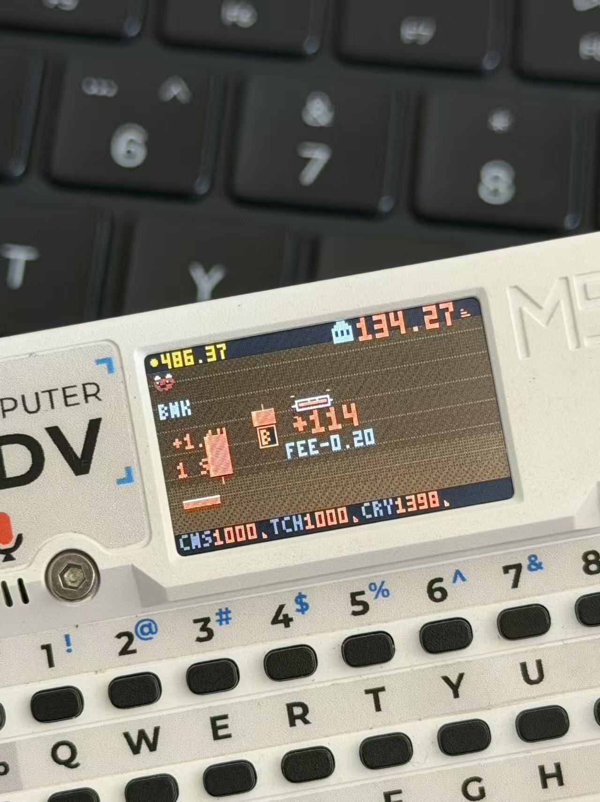

# 《行情机》TICKER

**一台放在桌上的行情机。** 拿起来玩几个交易日，一天 6 分钟，放下就走。



M5Stack Cardputer ADV（ESP32-S3 / 240×135 / 无 PSRAM）上的 GBC 风格像素交易小游戏。
一屏一区域、不卷动，冷色调 + Bayer 抖动，全部图形由代码逐像素画出。

## 玩法

一屏 6 根蜡烛：左边 5 根是历史，最右一根白框的是**活蜡烛**，你只在活蜡烛上操作。

- **一个交易日 = 12 根蜡烛（6 分钟）**，日终强制平仓，第二天换一只标的
- **买**：按现金 1/3 建仓，最多三档；股票只能整股，加密可以小数（赌博）
- **卖**：一档一档卖，卖完最后一档清仓
- **你的单子会推动价格**：盘口有深度，买单把价格推上去、卖单砸下去，越大越滑
- 每笔 0.25% 手续费；持仓每根蜡烛 0.15% 持仓费，付不出来就爆仓

### 市场不是随机数发生器

每只标的都有自己的**隐藏性格**（不写在界面上，玩多了自己会认出来）：

| 性格 | 表现 |
|---|---|
| 抗跌 | 负面冲击只有别人的一半（银行、公用事业） |
| 妖股 | 异象频繁，上蹿下跳（科技、小币） |
| 财报爱造假 | 造假概率三倍，被查出来之后**带疤三个交易日** |
| 鲸鱼常客 | 鲸鱼特别爱来（芯片、比特币、小币） |
| 冷门 | 安静，但跌了没人接 |

**异象不是「该买了」的信号。** 鲸鱼、灰犀牛、黑天鹅、瀑布、升天五类，每类三套剧本，
方向严格随机：同样是鲸鱼进场，可能砸穿，也可能只是虚晃一枪。事件会连续冲击几根，
走完还留一段余波，价位被拽走就不会自己弹回来。

**财报**是剧情岔路口：36% 预告、9% 突袭、其余平盘。结果有六种（超预期 / 不及 / 符合 /
下调指引 / 造假 / 利好出尽），会改写当天的走势剧本、放大波动、抬高持仓成本。
传闻 60% 会出现，但只有 55% 是真的。

**大盘会传染**：指数自己也在走，大盘崩的时候个股更容易出事；你逃不掉。

### 战绩册（`L`）

1. 今日权益曲线
2. 跨日权益 vs 大盘（归一化双线）
3. 六类异象收集 —— 集齐解锁一只新的妖股 `GAO`

### 关机不会丢

交易立刻落盘、每根蜡烛收盘落盘、跨日战绩日终落盘。整份存档带 CRC 校验，坏档丢弃重来。
**持仓中关机再开机，会接着那只票继续**（价格回到上一根收盘，跌的部分一起回退）。

### 省电

2 分钟没有按键 → 熄背光、面板休眠、CPU 降到 40MHz，游戏世界暂停；任意键唤醒。

## 键位

| 键 | 作用 |
|---|---|
| `B` / `空格` | 买入（1/3 现金，最多三档） |
| `S` | 卖出（一档，最后一档清仓） |
| `L` / `回车` | 战绩册（`A` / `D` 翻页） |
| `H` | 帮助 |
| `M` | 静音 |
| `C` | 红绿互换（默认红涨绿跌，美股惯例） |

## 构建

```bash
pio run -e cardputer                 # 固件（ESP32-S3 / 8MB / DIO）
pio run -e cardputer -t upload       # 刷机

# PC 模拟器（与固件共用 game.cpp / render.cpp，无平台依赖）
g++ -O2 -std=c++11 sim/sim.cpp src/game.cpp src/render.cpp -Isrc -o sim/sim
./sim/sim main                        # 出帧 PPM
./sim/sim title help book             # 启动页 / 帮助 / 战绩册
./sim/sim hold 240                    # 经济模拟：240 根蜡烛的平均权益
./sim/sim impact                      # 买入滑点实测
```

## 结构

- `src/game.*` 平台无关核心（价格模型 / 异象剧本 / 财报 / 交易 / 存档字段）
- `src/render.*` 平台无关渲染（GBC 冷色板 + Bayer 抖动 + 点阵字）
- `src/audio.cpp` tone() 音效表（≥45ms、单轨 SFX + BGM + 看门狗）
- `src/main.cpp` Cardputer 入口（键盘 / NVS 存档 / 启动页 / 省电）
- `src/palette.h` `src/glyph.h` 由 `tools/gen_assets.py` 生成，勿手改
- `sim/sim.cpp` PC 模拟器（出帧 + 经济模拟 + 玩法自检）

## 刷机说明

见 [releases/README_M5Burner.md](releases/README_M5Burner.md)。
M5Burner 商店：搜索 **TICKER**（作者 andjiang）。

## English

**TICKER** — a pocket market terminal for the M5Stack Cardputer ADV. GBC-style pixel
trading, six minutes per trading day, twelve candles a day, no scrolling.

- `B` buys a third of your cash (whole shares), `S` sells one tranche
- Your own orders move the price — bigger orders, worse fills
- Every ticker has a hidden personality (defensive / wild / fraudulent books / whale magnet / illiquid)
- Anomalies (whale, grey rhino, black swan, waterfall, moonshot) each have three random scripts —
  never assume "event = buy the dip"
- Earnings land 36% scheduled / 9% ambush; rumours show up 60% of the time and are true 55%
- Stock book (`L`): today's equity curve, equity vs the index across days, anomaly collection
- Save survives power loss and resumes an open position; idle 2 minutes → screen off, any key wakes

## License

MIT. See [LICENSE](LICENSE).
